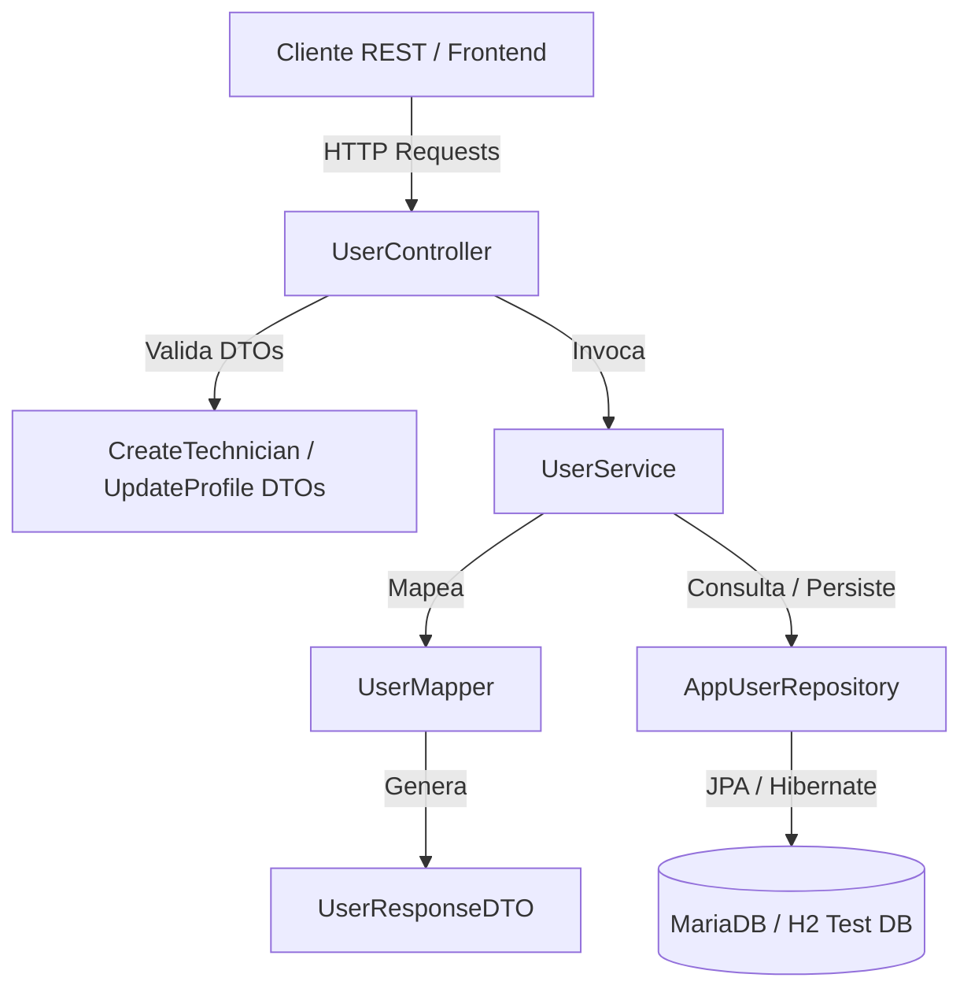

# Requirements

### Overview & Goals
El objetivo de este plan es iniciar la **Práctica 2** en el proyecto **BlueDeploy**, sustituyendo los usuarios simulados en el frontend (`mockUsers.js`) por un modelo de persistencia real en el backend Spring Boot 3.2.5 con MariaDB y H2 para testing.

En esta fase se deja preparada la capa de dominio, persistencia, lógica de negocio y API REST para la gestión de usuarios y técnicos, manteniendo la arquitectura limpia y consistente con el resto del proyecto antes de introducir JWT en fases posteriores.

### Scope

#### In Scope
- **Rama Git**: Crear y trabajar sobre la nueva rama `feature/user-persistence` derivada de `develop`.
- **Entidades y Enums**:
  - `UserRole` (`ADMIN`, `TECHNICIAN`).
  - `AppUser` (entidad JPA con id, username, password, name, email, department, role, enabled, timestamps).
- **Persistencia**:
  - `AppUserRepository` con métodos de búsqueda por username, email, role y comprobaciones de existencia.
- **DTOs & Mappers**:
  - `UserResponseDTO`
  - `CreateTechnicianRequestDTO`
  - `UpdateProfileRequestDTO`
  - `UserMapper`
- **Servicio & Lógica de Negocio**:
  - `UserService` con validación de unicidad, gestión de estados (enabled/disabled), actualización de perfil y separación de operaciones de admin y técnico.
- **Controlador REST**:
  - `UserController` con los siguientes endpoints:
    - `GET /api/users/me`
    - `PUT /api/users/me`
    - `GET /api/users/technicians`
    - `POST /api/users/technicians`
    - `PUT /api/users/technicians/{id}`
    - `PATCH /api/users/technicians/{id}/disable`
- **Tests de Integración**:
  - `UserApiIntegrationTest` contra H2 en memoria (`@ActiveProfiles("test")`).
  - Actualización de `BaseApiIntegrationTest` para limpieza de la base de datos de test.
- **Documentación & Notas**:
  - Actualización de `notes/03 Modelo de Dominio.md`, `notes/06 Roadmap Práctica 2.md`, `notes/11 Frontend Dashboard - Roles y Autenticacion.md` y `notes/12 Historial de Commits y Estrategia Git.md`.
- **Seguridad de Secretos**:
  - Verificación estricta de `.gitignore` para asegurar que ningún archivo con credenciales reales sea comiteado.

#### Out of Scope (reservado para fases posteriores)
- Implementación de tokens JWT y filtros de Spring Security (se abordará en la siguiente fase de la Práctica 2).
- Modificación de componentes del frontend React para consumir los nuevos endpoints (se realizará una vez validado el backend).
- Integración de API Keys para scripts PowerShell OSDCloud.

### User Stories
- **Como Administrador**, quiero registrar nuevos técnicos en el sistema (`POST /api/users/technicians`) para que puedan acceder y gestionar sus despliegues asignados.
- **Como Administrador**, quiero listar todos los técnicos (`GET /api/users/technicians`) y desactivar a los que causen baja (`PATCH /api/users/technicians/{id}/disable`) para mantener el control de acceso al panel.
- **Como Técnico**, quiero consultar y editar mi propio perfil (`GET /api/users/me`, `PUT /api/users/me`) para mantener actualizada mi información de contacto y credenciales sin acceder a la administración global.

### Functional Requirements
1. **Unicidad de credenciales**: `username` y `email` deben ser únicos en la base de datos. Si se intenta registrar un duplicado, se debe retornar HTTP 400 Bad Request con mensaje descriptivo.
2. **Validación de datos de entrada**: Todos los campos obligatorios deben validarse mediante anotaciones `@NotBlank`, `@Email`, `@Size` en los DTOs.
3. **Gestión de estado de técnico**: La deshabilitación de un técnico (`PATCH /api/users/technicians/{id}/disable`) debe cambiar el flag `enabled = false` sin borrar físicamente el registro (soft disable), preservando la integridad referencial con los despliegues.
4. **Listado filtrado por rol**: `GET /api/users/technicians` debe retornar únicamente usuarios con rol `TECHNICIAN`.
5. **Simulación de contexto para endpoints `/me`**: Dado que JWT se incorporará en el siguiente sprint, los endpoints `/me` permitirán identificar al usuario activo mediante la cabecera `X-User-Id` o `X-Username` (o usuario por defecto en test), facilitando la transición suave a `SecurityContextHolder` cuando se agregue JWT.

### Non-Functional Requirements
- **Compatibilidad**: Java 21, Spring Boot 3.2.5, JPA/Hibernate.
- **Base de datos**: MariaDB en entorno de desarrollo/producción, H2 en memoria para tests (`application-test.properties`).
- **Seguridad**: No versionar secretos ni contraseñas en claro. Mantener contraseñas fuera de las respuestas DTO (`password` nunca se incluye en `UserResponseDTO`).
- **Consistencia de diseño**: Utilizar el mismo patrón de mappers estáticos, DTOs y manejo global de excepciones (`GlobalExceptionHandler`) ya presente en `DeploymentController` y `SecurityCheckController`.

# Technical Design

### Current Implementation
Actualmente, el backend de BlueDeploy cuenta con los siguientes componentes:
- Modelos: `Deployment`, `DeploymentStep`, `SecurityCheck`, `Check`, `Alert`.
- Repositorios JPA correspondientes en `com.roblesdavid.blue_deploy.repository`.
- Controladores REST en `com.roblesdavid.blue_deploy.controller`: `DeploymentController`, `DeploymentStepController`, `SecurityCheckController`, `DashboardController`, `CheckController`.
- Mappers utilitarios: `DeploymentMapper`, `DeploymentStepMapper`, `SecurityCheckMapper`, `CheckMapper`.
- Manejo centralizado de excepciones con `GlobalExceptionHandler` y `ApiErrorResponse`.
- El frontend gestionaba los usuarios de forma estática en `frontend/src/data/mockUsers.js` con roles `ADMIN` y `TECHNICIAN`.
- `SecurityConfig` está definido como placeholder sin reglas restrictivas para permitir la integración progresiva.

### Key Decisions
1. **Estructura del Modelo `AppUser` y `UserRole`**:
   - `UserRole`: Enum con valores `ADMIN` y `TECHNICIAN`.
   - `AppUser`: Nombre de entidad y tabla `app_user` (evitando la palabra reservada `user` en MariaDB y MySQL).
   - Campos: `id` (Long), `username` (VARCHAR 50, UNIQUE), `password` (VARCHAR 255), `name` (VARCHAR 100), `email` (VARCHAR 100, UNIQUE), `department` (VARCHAR 100), `role` (ENUM STRING), `enabled` (BOOLEAN, default true), `createdAt` (LocalDateTime), `updatedAt` (LocalDateTime).
2. **Estrategia para endpoints `/me` antes de JWT**:
   - Para permitir probar los endpoints `GET /api/users/me` y `PUT /api/users/me` de forma desacoplada antes de introducir Spring Security con JWT, se resolverá el usuario activo mediante el header `X-User-Id` o `X-Username` (con fallback de desarrollo controlado). Al implementar JWT, este mecanismo se sustituirá directamente por `@AuthenticationPrincipal` sin cambiar la firma del servicio.
3. **Mapeo y Seguridad de Datos**:
   - `UserMapper.toDTO(AppUser)` genera `UserResponseDTO` con campos públicos e iniciales (`initials`), excluyendo expresamente el campo `password`.
4. **Desactivación de Usuarios (Soft Disable)**:
   - En lugar de borrado físico (`DELETE`), se utiliza el endpoint `PATCH /api/users/technicians/{id}/disable` para setear `enabled = false`, evitando romper relaciones con historiales de despliegue.

### Architecture Diagram


### Data Models & Contracts

#### 1. Enum `UserRole`
```java
package com.roblesdavid.blue_deploy.model;

public enum UserRole {
    ADMIN,
    TECHNICIAN
}
```

#### 2. Entidad `AppUser`
```java
package com.roblesdavid.blue_deploy.model;

import jakarta.persistence.*;
import java.time.LocalDateTime;

@Entity
@Table(name = "app_user")
public class AppUser {
    @Id
    @GeneratedValue(strategy = GenerationType.IDENTITY)
    private Long id;

    @Column(nullable = false, unique = true, length = 50)
    private String username;

    @Column(nullable = false)
    private String password;

    @Column(nullable = false, length = 100)
    private String name;

    @Column(nullable = false, unique = true, length = 100)
    private String email;

    @Column(length = 100)
    private String department;

    @Enumerated(EnumType.STRING)
    @Column(nullable = false, length = 20)
    private UserRole role;

    @Column(nullable = false)
    private Boolean enabled = true;

    @Column(name = "created_at", nullable = false)
    private LocalDateTime createdAt;

    @Column(name = "updated_at")
    private LocalDateTime updatedAt;

    // Getters, Setters, Helpers (getInitials)
}
```

#### 3. DTOs
- **`CreateTechnicianRequestDTO`**:
  - `username` (`@NotBlank`, `@Size(min = 3, max = 50)`)
  - `password` (`@NotBlank`, `@Size(min = 6)`)
  - `name` (`@NotBlank`)
  - `email` (`@NotBlank`, `@Email`)
  - `department` (`@NotBlank`)
- **`UpdateProfileRequestDTO`**:
  - `name` (`@NotBlank`)
  - `email` (`@NotBlank`, `@Email`)
  - `department` (String)
  - `currentPassword` (String, opcional)
  - `newPassword` (String, opcional)
- **`UserResponseDTO`**:
  - `id`, `username`, `name`, `initials`, `email`, `role`, `department`, `enabled`, `createdAt`, `updatedAt`.

### File Structure Changes
```
src/main/java/com/roblesdavid/blue_deploy/
├── model/
│   ├── UserRole.java              (Nuevo)
│   └── AppUser.java               (Nuevo)
├── repository/
│   └── AppUserRepository.java     (Nuevo)
├── dto/
│   ├── UserResponseDTO.java       (Nuevo)
│   ├── CreateTechnicianRequestDTO.java (Nuevo)
│   └── UpdateProfileRequestDTO.java    (Nuevo)
├── mapper/
│   └── UserMapper.java            (Nuevo)
├── service/
│   └── UserService.java           (Nuevo)
└── controller/
    └── UserController.java        (Nuevo)

src/test/java/com/roblesdavid/blue_deploy/integration/
├── BaseApiIntegrationTest.java    (Modificado: limpieza de AppUserRepository)
└── UserApiIntegrationTest.java    (Nuevo)
```

### Risks & Mitigations
- **Riesgo**: Colisión del nombre de tabla `user` con palabras reservadas SQL en MariaDB/H2.
  - *Mitigación*: Nombrar la entidad y tabla explícitamente como `app_user`.
- **Riesgo**: Exposición accidental de contraseñas en respuestas JSON.
  - *Mitigación*: `UserResponseDTO` y `UserMapper` no contienen ni transfieren el atributo `password`.
- **Riesgo**: Duplicidad de emails o usernames provocando errores 500 no controlados.
  - *Mitigación*: Validaciones preventivas en `UserService` con `existsByUsername` y `existsByEmail` lanzando `IllegalArgumentException`, capturadas con código 400 por `GlobalExceptionHandler`.

# Notes & Git Strategy

### Git Branch Strategy
Siguiendo las convenciones del repositorio especificadas en `notes/05 Git Workflow.md`:
1. Partir siempre desde la rama `develop`:
   ```bash
   git checkout develop
   git pull origin develop
   git checkout -b feature/user-persistence
   ```
2. Realizar commits pequeños y atómicos según la convención `<tipo>(<alcance>): <descripción>`.
3. Una vez validados los tests, fusionar en `develop`.

---

### Atomic Commits Roadmap

#### Commit 1 — Modelo de dominio y repositorio
```
feat(backend): add AppUser entity, UserRole enum and AppUserRepository
```
- **Ficheros**:
  - `src/main/java/com/roblesdavid/blue_deploy/model/UserRole.java`
  - `src/main/java/com/roblesdavid/blue_deploy/model/AppUser.java`
  - `src/main/java/com/roblesdavid/blue_deploy/repository/AppUserRepository.java`

#### Commit 2 — DTOs y Mappers
```
feat(backend): add UserResponseDTO, CreateTechnicianRequestDTO, UpdateProfileRequestDTO and UserMapper
```
- **Ficheros**:
  - `src/main/java/com/roblesdavid/blue_deploy/dto/UserResponseDTO.java`
  - `src/main/java/com/roblesdavid/blue_deploy/dto/CreateTechnicianRequestDTO.java`
  - `src/main/java/com/roblesdavid/blue_deploy/dto/UpdateProfileRequestDTO.java`
  - `src/main/java/com/roblesdavid/blue_deploy/mapper/UserMapper.java`

#### Commit 3 — Servicio de gestión de usuarios
```
feat(backend): add UserService with technician management and profile update logic
```
- **Ficheros**:
  - `src/main/java/com/roblesdavid/blue_deploy/service/UserService.java`

#### Commit 4 — Controlador REST de usuarios
```
feat(backend): add UserController exposing /api/users/me and /api/users/technicians endpoints
```
- **Ficheros**:
  - `src/main/java/com/roblesdavid/blue_deploy/controller/UserController.java`

#### Commit 5 — Tests de integración con H2
```
test(backend): add UserApiIntegrationTest with H2 database and update BaseApiIntegrationTest
```
- **Ficheros**:
  - `src/test/java/com/roblesdavid/blue_deploy/integration/BaseApiIntegrationTest.java`
  - `src/test/java/com/roblesdavid/blue_deploy/integration/UserApiIntegrationTest.java`

#### Commit 6 — Actualización de notas y documentación
```
docs: update domain model, roadmap and commit history notes for user persistence
```
- **Ficheros**:
  - `notes/03 Modelo de Dominio.md`
  - `notes/06 Roadmap Práctica 2.md`
  - `notes/11 Frontend Dashboard - Roles y Autenticacion.md`
  - `notes/12 Historial de Commits y Estrategia Git.md`

---

### Actualización de Documentación (`notes/`)

#### 1. `notes/03 Modelo de Dominio.md`
- **Añadir sección**: `## Entidad AppUser y Roles`
- **Contenido a incorporar**:
  - Descripción de `AppUser` y campos (`id`, `username`, `password`, `name`, `email`, `department`, `role`, `enabled`, `createdAt`, `updatedAt`).
  - Descripción de `UserRole` (`ADMIN`, `TECHNICIAN`).
  - Reglas de negocio: unicidad de username y email, desactivación lógica con flag `enabled`.

#### 2. `notes/06 Roadmap Práctica 2.md`
- **Actualizar tabla de mejoras planificadas**:
  - Marcar como completada la etapa de persistencia de usuarios y modelo `AppUser`.
  - Detallar que los endpoints REST de usuarios ya están listos para la integración con Spring Security y JWT en el siguiente paso.

#### 3. `notes/11 Frontend Dashboard - Roles y Autenticacion.md`
- **Actualizar sección `Pending (Práctica 2)`**:
  - Documentar los endpoints implementados: `GET/PUT /api/users/me`, `GET/POST /api/users/technicians`, `PUT /api/users/technicians/{id}`, `PATCH /api/users/technicians/{id}/disable`.
  - Indicar la equivalencia de campos entre `mockUsers.js` y `UserResponseDTO`.

#### 4. `notes/12 Historial de Commits y Estrategia Git.md`
- **Añadir sección**: `### Sprint 8 — Persistencia de Usuarios y Modelo AppUser (Práctica 2)`
- **Registrar la lista de commits planificados** con sus ficheros asociados y descripciones.

---

### Verificación de Seguridad y Gitignore
- Comprobar que `.gitignore` tiene excluidos:
  - Archivos de variables de entorno: `.env`, `.env.local`, `.env.production` (solo se versionan `.env.example` y `.env.production.example`).
  - Tokens y credenciales locales: `.TokenAccess`, `notes/Guias/`, logs (`*.log`, `logs/`).
- Verificar que en el código fuente de entidades, servicios y controladores **no se incluyan credenciales hardcodeadas**.
- En `application.properties`, los valores de base de datos se obtienen de variables de entorno (`${DB_NAME}`, `${DB_USER}`, `${DB_PASSWORD}`), manteniendo seguro el repositorio.

# Testing

### Validation Approach
La validación se realizará mediante tests de integración automatizados con MockMvc y base de datos H2 en memoria (`@SpringBootTest`, `@AutoConfigureMockMvc`, `@ActiveProfiles("test")`), ejecutando la suite completa mediante `./mvnw clean test`.

### Key Scenarios in `UserApiIntegrationTest`

1. **Creación de Técnicos (`POST /api/users/technicians`)**:
   - Crear un técnico con datos válidos -> HTTP 201 Created y retorno de `UserResponseDTO` con rol `TECHNICIAN`, flag `enabled = true` y sin campo `password`.
   - Intentar crear un técnico con username duplicado -> HTTP 400 Bad Request.
   - Intentar crear un técnico con email duplicado -> HTTP 400 Bad Request.
   - Intentar crear con payload inválido (email no válido o campos vacíos) -> HTTP 400 Bad Request.

2. **Listado de Técnicos (`GET /api/users/technicians`)**:
   - Registrar un ADMIN y dos TECHNICIANs.
   - Consultar `GET /api/users/technicians` -> HTTP 200 OK devolviendo exactamente 2 elementos (solo los de rol `TECHNICIAN`).

3. **Edición de Técnicos (`PUT /api/users/technicians/{id}`)**:
   - Actualizar nombre, email o departamento de un técnico existente -> HTTP 200 OK con datos actualizados.
   - Intentar actualizar un ID no existente -> HTTP 404 Not Found.

4. **Deshabilitación de Técnicos (`PATCH /api/users/technicians/{id}/disable`)**:
   - Deshabilitar un técnico activo -> HTTP 200 OK con `enabled = false`.
   - Comprobar persistencia del estado en base de datos.
   - Intentar deshabilitar un ID no existente -> HTTP 404 Not Found.

5. **Consulta de Perfil Propio (`GET /api/users/me`)**:
   - Consultar perfil con usuario identificado -> HTTP 200 OK con los datos del usuario correspondiente.

6. **Actualización de Perfil Propio (`PUT /api/users/me`)**:
   - Actualizar datos propios (nombre, email, departamento) -> HTTP 200 OK.
   - Cambio de contraseña verificando validación de contraseña actual y asignación de nueva contraseña.

### Edge Cases & Regressions
- **Limpieza de base de datos**: Asegurar que `BaseApiIntegrationTest.cleanupDatabase()` incluye `appUserRepository.deleteAll()` antes de cada test para evitar interferencias entre suites.
- **Regresiones**: Ejecutar los tests existentes (`DeploymentApiIntegrationTest`, `DeploymentStepApiIntegrationTest`, `SecurityCheckApiIntegrationTest`, `DashboardApiIntegrationTest`, `LegacyCheckApiIntegrationTest`) para certificar que la nueva entidad y endpoints no alteran el comportamiento existente.

# Delivery Steps

###   Step 1: Crear rama de trabajo y definir modelo de dominio y repositorio (AppUser, UserRole, AppUserRepository)
La rama `feature/user-persistence` está creada desde `develop`, el enum `UserRole` y la entidad `AppUser` están definidos con JPA y el repositorio `AppUserRepository` está operativo.

- Crear y cambiar a la rama `feature/user-persistence` desde la rama `develop`.
- Crear el enum `UserRole` con los valores `ADMIN` y `TECHNICIAN` en el paquete `com.roblesdavid.blue_deploy.model`.
- Crear la entidad `@Entity` `AppUser` mapeada a la tabla `app_user` con los campos: `id`, `username` (único, no nulo), `password` (no nula), `name`, `email` (único, no nulo), `department`, `role` (`UserRole`, `@Enumerated(EnumType.STRING)`), `enabled` (boolean, default true), `createdAt`, `updatedAt` y método helper para calcular iniciales (`getInitials()`).
- Crear la interfaz `AppUserRepository` en `com.roblesdavid.blue_deploy.repository` extendiendo `JpaRepository<AppUser, Long>` con métodos `findByUsername(String username)`, `findByEmail(String email)`, `findByRole(UserRole role)`, `existsByUsername(String username)` y `existsByEmail(String email)`.

###   Step 2: Implementar DTOs y UserMapper
Los contratos DTO para creación, actualización y respuesta están creados con validaciones Bean Validation y el mapper bidireccional está implementado.

- Crear `UserResponseDTO` con campos serializables (`id`, `username`, `name`, `email`, `role`, `department`, `initials`, `enabled`, `createdAt`, `updatedAt`).
- Crear `CreateTechnicianRequestDTO` con anotaciones `@NotBlank`, `@Email`, `@Size` para validación estricta de entrada en altas de técnicos.
- Crear `UpdateProfileRequestDTO` con campos editables del perfil (`name`, `email`, `department`, `currentPassword`, `newPassword`) con anotaciones de validación.
- Crear `UserMapper` en `com.roblesdavid.blue_deploy.mapper` para transformar entidades `AppUser` a `UserResponseDTO` de forma consistente con `DeploymentMapper` y `SecurityCheckMapper`.

###   Step 3: Implementar UserService con lógica de negocio y validaciones
El servicio `UserService` contiene la lógica de negocio para gestión de técnicos, actualización de perfiles y habilitación/deshabilitación.

- Crear la clase `@Service` `UserService` inyectando `AppUserRepository`.
- Implementar `getTechnicians()` para obtener todos los usuarios con rol `TECHNICIAN`.
- Implementar `createTechnician(CreateTechnicianRequestDTO dto)` validando que el username y email no existan previamente y asignando rol `TECHNICIAN` y `enabled = true`.
- Implementar `updateTechnician(Long id, UpdateProfileRequestDTO dto)` para actualizar los datos de un técnico existente.
- Implementar `disableTechnician(Long id)` / `toggleTechnicianStatus(Long id, boolean enabled)` para desactivar técnicos mediante actualización del flag `enabled`.
- Implementar `getCurrentUserProfile(String username)` y `updateCurrentUserProfile(String username, UpdateProfileRequestDTO dto)` con validación de cambio de contraseña.

###   Step 4: Implementar UserController con los endpoints REST requeridos
El controlador `UserController` expone los 6 endpoints REST solicitados bajo `/api/users` integrándose con `GlobalExceptionHandler`.

- Crear `@RestController` `UserController` bajo la ruta `@RequestMapping("/api/users")`.
- Exponer `GET /api/users/me` devolviendo el perfil del usuario autenticado/solicitante (`UserResponseDTO`).
- Exponer `PUT /api/users/me` recibiendo `@Valid @RequestBody UpdateProfileRequestDTO` para actualizar el propio perfil.
- Exponer `GET /api/users/technicians` devolviendo `List<UserResponseDTO>`.
- Exponer `POST /api/users/technicians` con código HTTP 201 Created para alta de nuevos técnicos.
- Exponer `PUT /api/users/technicians/{id}` para actualizar datos del técnico por ID.
- Exponer `PATCH /api/users/technicians/{id}/disable` para deshabilitar técnicos.
- Asegurar que las validaciones y errores 400/404 se canalicen limpiamente a través de `GlobalExceptionHandler`.

###   Step 5: Crear tests de integración con base de datos H2
La suite de tests de integración en H2 cubre todos los flujos de creación, consulta, modificación y deshabilitación de usuarios.

- Actualizar `BaseApiIntegrationTest` para inyectar `AppUserRepository` y limpiar la tabla en `@BeforeEach`.
- Crear `UserApiIntegrationTest` en `src/test/java/com/roblesdavid/blue_deploy/integration/` con perfil `@ActiveProfiles("test")`.
- Implementar tests de `POST /api/users/technicians` (éxito 201, error 400 por campos inválidos, error 400 por username duplicado).
- Implementar tests de `GET /api/users/technicians` (comprobando que solo lista técnicos y no administradores).
- Implementar tests de `PUT /api/users/technicians/{id}` y `PATCH /api/users/technicians/{id}/disable` (comprobando cambio de estado y 404 en IDs inexistentes).
- Implementar tests de `GET /api/users/me` y `PUT /api/users/me` validando actualización de datos.
- Ejecutar `./mvnw clean test` para asegurar que pasan todos los tests existentes y los nuevos.

###   Step 6: Actualizar documentación en notes, verificación de seguridad y registro de commits
La documentación en la carpeta notes est�� actualizada, los commits atómicos están preparados y se ha verificado la ausencia de secretos en el repositorio.

- Actualizar `notes/03 Modelo de Dominio.md` añadiendo la sección de `AppUser`, `UserRole` y sus atributos.
- Actualizar `notes/06 Roadmap Práctica 2.md` marcando la fase de persistencia de usuarios completada.
- Actualizar `notes/11 Frontend Dashboard - Roles y Autenticacion.md` documentando la transición de mock users a los endpoints de backend.
- Actualizar `notes/12 Historial de Commits y Estrategia Git.md` registrando los commits del Sprint 8 (Práctica 2 - Persistencia de Usuarios).
- Verificar que `.gitignore` excluye `.env`, `.TokenAccess`, credenciales y logs.
- Comprobar que ningún archivo versionado contiene contraseñas en texto plano o secretos sensibles.